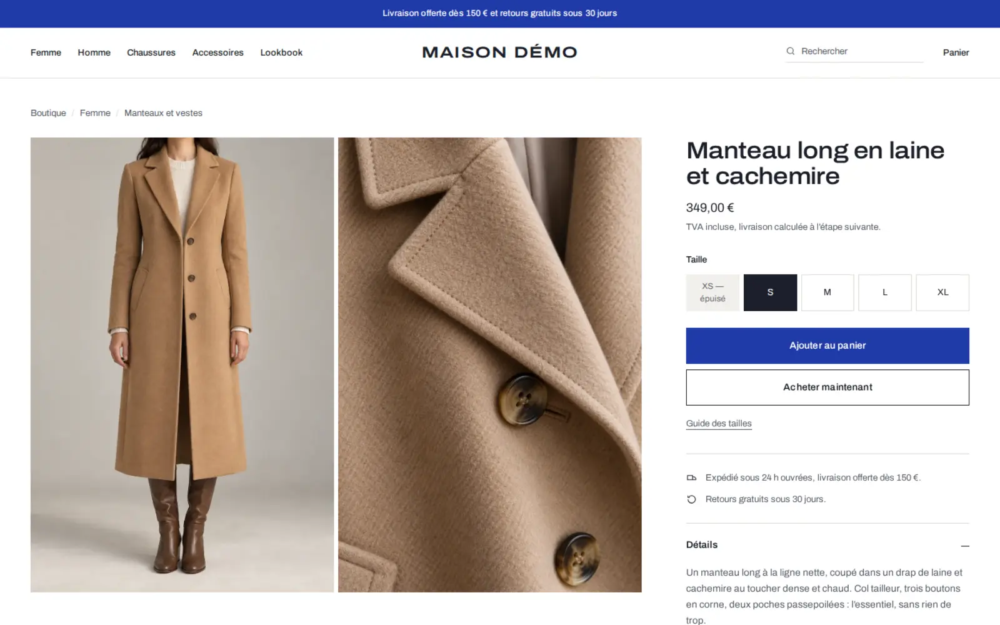

# Maison Démo

Boutique de démonstration d'une maison de prêt-à-porter parisienne, femme et
homme : vêtements, chaussures et accessoires. Elle montre ce que le socle
[minshop-platform](https://github.com/DamienGR/minshop-platform) permet de
construire pour un commerçant, sans rien changer à son fonctionnement : le
panier, le paiement, les stocks et l'administration sont ceux du socle ; le
design, le catalogue et les contenus sont ceux de la boutique.


| | |
| --- | --- |
|  |  |

## Ce que contient la démonstration

- **Un thème sur mesure**, `src/themes/maison-demo/` : une page blanche, une
  seule couleur d'accent (un bleu Klein réservé à la marque et aux actions) et
  un seul caractère, Archivo, dont l'axe de chasse donne à la fois la marque, les
  grands titres et le texte courant. Vitrine éditoriale à l'accueil, catalogue,
  fiche produit à galerie et choix de taille, pages de contenu.
- **Un catalogue complet** : 44 produits, 187 tailles, 88 photographies, 19
  rayons sur deux niveaux, des produits épuisés et des stocks faibles, importés
  par `shopctl catalog import` depuis `imports/catalog.csv`.
- **Onze pages** : l'histoire de la maison, les matières, un lookbook, le guide
  des tailles, la livraison et les retours, une FAQ, le contact et les quatre
  pages légales (CGV, mentions légales, confidentialité, rétractation).
- **Un parcours d'achat de bout en bout** : panier latéral, acceptation des CGV,
  livraison offerte dès 150 €, paiement de démonstration sans débit, page de
  confirmation avec la TVA.
- **Une administration vivante** : un historique de commandes fictives sur 30
  jours, clients, expéditions suivies, tableau de bord.

Tout est fictif : la société, ses coordonnées, ses clients. Les photographies
ont été générées pour cette démonstration.

## Essayer en local

```sh
nvm use 22
npm ci && npm ci --prefix mcp
npm run db:migrate
node client/demo/seed.mjs
npm run dev
```

Ouvrez <http://localhost:4321>, créez le mot de passe d'administration sur
`/admin/setup`, puis, si vous voulez un historique de commandes :

```sh
node client/demo/orders.mjs http://localhost:4321
```

## Mettre en ligne

La procédure pas à pas, de la connexion à Cloudflare jusqu'à la vérification,
est dans [`client/demo/MISE-EN-LIGNE.md`](demo/MISE-EN-LIGNE.md). Le
détail des contenus et des scripts de chargement est dans
[`client/demo/README.md`](demo/README.md).

## Le socle

Cette boutique est un clone du tag `v0.3.5` de minshop-platform, avec son
historique : elle reçoit les versions suivantes du socle par fusion
(`npm run shopctl -- core upgrade`). La documentation du socle reste dans le
[README racine](../README.md), [`AGENTS.md`](../AGENTS.md) et
[`CUSTOMIZING.md`](../CUSTOMIZING.md).
